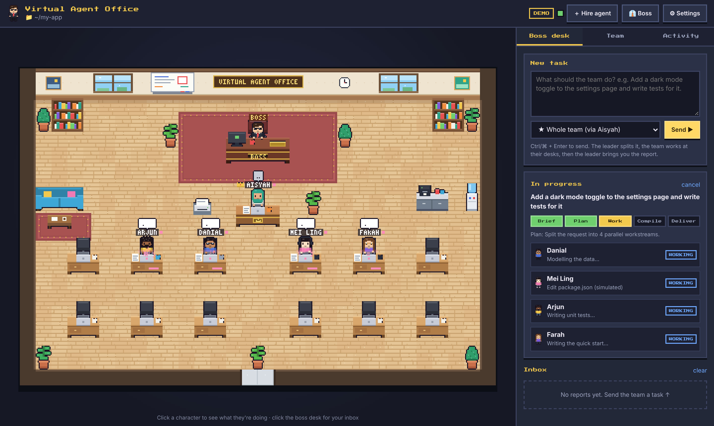

# Virtual Agent Office

A top-down pixel office where your AI coding CLIs work as a team.

You sit at the **boss desk**. Each agent has a desk, a name, a look you design, and a "brain" (Claude Code, Codex, Antigravity, Gemini CLI, Hermes Agent, or any other CLI). When you hand in a task:

1. The **leader** (★, your choice) walks over to your desk to pick up the brief.
2. The leader goes back to their desk, plans, and hands out assignments. You can watch the papers fly to each desk.
3. Every member **sits at their desk and types**. Their CLI really is running, and you can watch its output live.
4. When a member is done, they **walk to the leader's desk** and hand in their report.
5. The leader **compiles** everything and **walks it to your desk**. The report lands in your inbox, and a Markdown copy is saved in the project.



## Features

- **Mix any CLIs in one team:** Claude Code, OpenAI Codex, Antigravity CLI (`agy`), Gemini CLI, Hermes Agent, a **custom command** (aider, opencode, qwen, your own script…), or the built-in **Demo** engine, which needs nothing installed.
- **Pick the leader.** Any agent can be leader. Change it anytime and they swap desks.
- **Character builder:** name, role, skin tone, 12 hair styles (including hijab/tudung and cap), hair & clothing colours (plus custom colour picker), glasses/sunglasses, headphones, beard, tie, scarf… and a personality / standing instructions that goes into every prompt.
- **Per-agent settings:** model, autonomy (read-only / auto-edit / full auto), extra CLI args.
- **Live view:** typing animation, code particles in the engine's colour, status bubbles. Click anyone to see their terminal output streaming.
- **Boss desk inbox:** compiled reports with each member's report attached. They're also saved to `<workspace>/.agent-office/reports/*.md`.
- **Direct tasks:** skip the leader and give one agent a job; they bring the result straight to you.
- **Idle life:** agents wander to the water cooler or the coffee machine when they have nothing to do.
- **Bring your own pixel art:** drop in a top-down asset pack (e.g. from itch.io) via a small manifest. See [docs/ASSETS.md](docs/ASSETS.md).

## Quick start

Requires **Node.js 18.17+**.

```bash
git clone https://github.com/amirnaqib/virtual-agent-office.git
```

```bash
cd virtual-agent-office && npm install
```

Try it with simulated agents first (no CLIs needed):

```bash
npm run demo
```

Then point it at a real project:

```bash
node bin/vao.js --workspace /path/to/your/project
```

To get a global `vao` / `virtual-agent-office` command:

```bash
npm install -g .
```

The office opens at <http://127.0.0.1:4317>. On first launch you get a sample team. Every agent whose CLI isn't installed starts on the Demo engine. Open **Team → Edit** to switch engines, rename people and restyle them.

### CLI options

| Option | Default | |
|---|---|---|
| `-w, --workspace <dir>` | current folder | Where agents work (they all share it) |
| `-p, --port <n>` | `4317` | |
| `--host <addr>` | `127.0.0.1` | Keep it local unless you know what you're doing |
| `--home <dir>` | `~/.virtual-agent-office` | Team, history and asset pack live here (`VAO_HOME` works too) |
| `--assets <dir>` | `<home>/assets` | Custom asset pack folder |
| `--demo` | | New offices start everyone on the Demo engine |
| `--no-open` | | Don't open a browser |

## Engines

Each engine is a thin adapter that turns *(prompt, agent, phase)* into a command line. Planning and report-writing always run **read-only**. The agent's autonomy setting only applies to the actual work.

| Engine | Command | Read-only | Auto-edit | Full auto |
|---|---|---|---|---|
| Claude Code | `claude -p --output-format stream-json --verbose` (prompt on stdin) | default permissions | `--permission-mode acceptEdits` | `--dangerously-skip-permissions` |
| OpenAI Codex | `codex exec --skip-git-repo-check --output-last-message <tmp> -` (prompt on stdin) | `--sandbox read-only` | `--full-auto` | `--dangerously-bypass-approvals-and-sandbox` |
| Antigravity CLI | `agy -p <prompt>` | default | `--mode accept-edits` | `--dangerously-skip-permissions` |
| Gemini CLI | `gemini -p <prompt>` | default | `--approval-mode auto_edit` | `--yolo` |
| Hermes Agent | `hermes chat -Q -q <prompt>` | default | default | `--yolo` |
| Custom | your template, e.g. `aider --yes-always --message {prompt}` | – | – | – |
| Demo | simulated | – | – | – |

`--model` / `-m` is added when you set a model. Anything else goes in **Extra args**.

> CLIs change their flags between versions. The Claude Code, Codex and Gemini flags above are their documented non-interactive modes. The **Antigravity (`agy`)** and **Hermes** flags come from their docs and cheat sheets, but they haven't been tested end-to-end here. If your version differs, check `agy --help` / `hermes chat --help` and adjust with **Extra args**, or switch that agent to the **Custom** engine with your own template.
> Antigravity: sign in once by running `agy` interactively before using it here.

**Custom engine placeholders:** `{prompt}`, `{model}`, `{workspace}`. If the template has no `{prompt}`, the prompt is sent on stdin. Placeholders are substituted *after* the template is split into arguments, so prompt text can never inject extra arguments.

## How the agents talk to each other

```
 Boss desk ──task──▶ Leader ──plan (JSON)──▶ assignments
                                              │
                    ┌─────────────┬───────────┴───────────┐
                    ▼             ▼                       ▼
                 Member A      Member B     …          Member N     (parallel, same workspace)
                    │ REPORT:     │ REPORT:               │ REPORT:
                    └─────────────┴───────────┬───────────┘
                                              ▼
                                   Leader compiles report ──▶ Boss desk inbox
```

- The leader gets the team roster (names, roles, engines, personalities) and must reply with JSON assignments. If the leader's output can't be parsed, every member gets the whole task, framed by their role.
- Each member's prompt includes their assignment, the boss's original request, and what each teammate is doing, so they stay out of each other's files.
- Members finish with a `REPORT:` section. The leader receives all reports, including failures, and writes the final Markdown report for you.
- Tasks run one at a time. Sending more puts them in a queue.

## Safety

- The server only listens on `127.0.0.1` and rejects WebSocket connections from other origins, so other websites can't drive your agents.
- Agents run **as you**, in the workspace folder. **Auto-edit** and especially **Full auto** let a CLI change files and run commands without asking. Use git, start with read-only or auto-edit, and only give full auto to engines you trust.
- Several agents share one folder. The leader is told to split work by file, but conflicts are still possible. Commit before big tasks.

## Data

- `~/.virtual-agent-office/office.json`: team, leader, boss, settings
- `~/.virtual-agent-office/history.json`: inbox (last 100 tasks)
- `<workspace>/.agent-office/reports/`: Markdown copy of every report (turn off in Settings). Add `.agent-office/` to your project's `.gitignore` if you don't want them committed.

## Development

```bash
npm test
```

```
bin/vao.js            CLI entry
server/index.js       HTTP + WebSocket server (localhost only, origin-checked)
server/orchestrator.js  boss → leader → team → leader → boss workflow
server/engines.js     CLI adapters + output parsers
server/runner.js      process spawning, streaming, timeouts, cancel
server/prompts.js     plan / work / compile prompts, plan parsing
public/js/scene.js    canvas renderer, walking, typing, papers
public/js/sprites.js  procedural pixel art (characters & furniture)
public/js/map.js      office floor plan · path.js A* pathfinding
public/js/builder.js  character builder
```

No build step, no framework, one runtime dependency (`ws`).

## Ideas for next

- An MCP server so agents can message the leader or each other *during* work, not only at the end
- Per-agent git worktrees to remove edit conflicts
- Review rounds (leader sends work back with feedback)
- Sound effects, day/night windows, more rooms

---

## Ringkasan (Bahasa Melayu)

**Virtual Agent Office** ialah pejabat piksel *top-down* di mana CLI AI anda (Claude Code, Codex, Antigravity, Gemini, Hermes atau CLI lain) bekerja sebagai satu pasukan.

- **Pilih ketua (★)**, beri nama dan reka watak setiap agent: rambut (termasuk tudung), warna baju, cermin mata, headphone, personaliti dan lain-lain.
- Bila anda hantar tugasan dari **meja boss**, ketua datang ambil, rancang dan bahagikan kerja. Setiap agent **duduk di meja masing-masing dan menaip**. CLI sebenar sedang berjalan dan output boleh dilihat secara langsung.
- Bila siap, agent **berjalan ke meja ketua** untuk hantar laporan. Ketua **kompil** semua laporan dan **bawa ke meja boss**. Laporan masuk ke inbox anda dan disimpan sebagai Markdown dalam projek.

Cuba dahulu tanpa sebarang CLI:

```bash
npm install && npm run demo
```

Guna pada projek sebenar:

```bash
node bin/vao.js --workspace /laluan/ke/projek
```

Aset piksel sendiri (contohnya dari itch.io) boleh dimasukkan melalui `~/.virtual-agent-office/assets/`. Lihat [docs/ASSETS.md](docs/ASSETS.md). Jangan *commit* aset berbayar ke repo awam, kerana kebanyakan lesen itch.io tidak membenarkannya.

## License

MIT for the code. All built-in pixel art is drawn procedurally in `public/js/sprites.js` and is covered by the same license.
